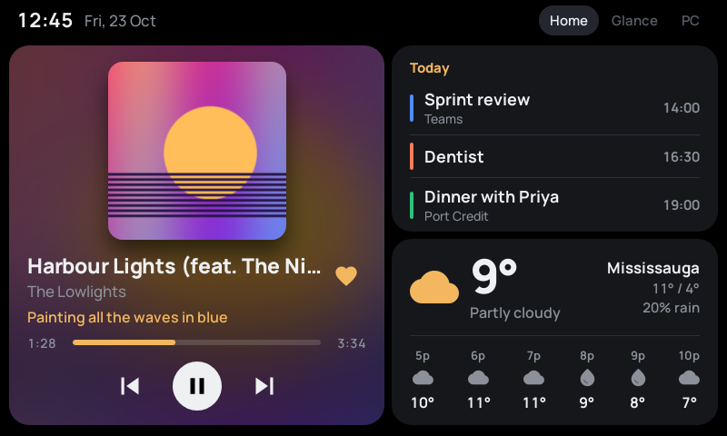
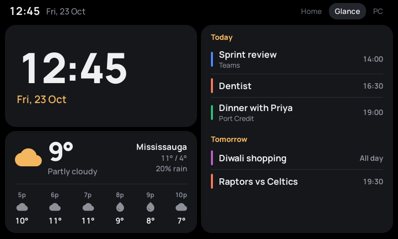
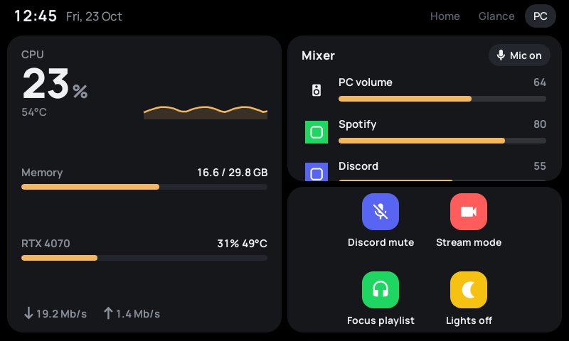
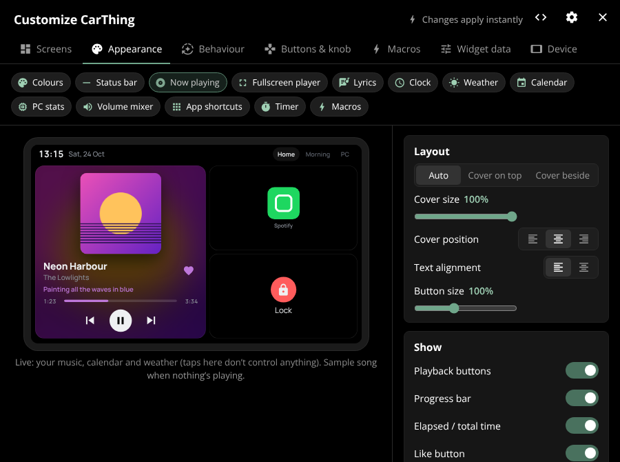

# VibeThing

Turns a Spotify CarThing plugged into a Windows PC into a small desk screen: now playing from any app, lyrics, calendar, weather, PC stats, a volume mixer, a timer and macros. You lay out the screens from the desktop app and the CarThing updates live.

A fork of [GlanceThing](https://github.com/BluDood/GlanceThing) by BluDood.



## Install

Windows only.

1. Grab the installer (`VibeThing-<version>-setup.exe`) or the portable zip from [Releases](../../releases/).
2. Run it. The setup guide flashes the CarThing if it needs it, connects it, and asks for a music source.

Close GlanceThing first if you have it running; only one app can talk to the CarThing at a time. Your GlanceThing settings are copied over on first launch.

**VLC:** VLC 3 doesn't report playback to Windows. Install [vlc-win10smtc](https://github.com/spmn/vlc-win10smtc), or enable VLC's web interface and put its password in Customize → Widget data → VLC.

## What's different from GlanceThing

- **Your own screens:** up to 3 columns of widgets per screen, as many screens as you want, built by drag and drop.
- **Any media source:** Spotify, YouTube, VLC, or anything else Windows sees, including wide video thumbnails.
- **More widgets:** calendar (any ICS link), weather, PC stats (CPU, memory, GPU, network), per-app volume, app shortcuts, macros, and a dial-set timer with a Windows notification.
- **Fullscreen player** with synced lyrics and up next.
- **Appearance editor** with a live CarThing preview: text size and weight per widget, player layout, themes, accent from album art or picked.
- **Behaviour:** auto-switch screens when music starts or stops, scheduled night dimming, screensaver or sleep.
- **Remappable controls** for every button press, hold and the dial.
- **Backup and restore** of all settings.

<p>
  
  
</p>

## Default controls

- **Buttons 1–3:** open screens 1–3. Hold button 3 to lock the PC.
- **Button 4:** fullscreen lyrics. Hold to like the current song.
- **Dial:** turn for volume, press to play or pause.

Change them under Buttons & knob. Closing the desktop window leaves VibeThing in the tray; quit it from Settings.



## Building

```bash
npm ci
npm run dev         # desktop app with hot reload
npm run build:win   # CarThing client + app, output in dist/
```

The CarThing interface is in `client/`. Run `npm run dev` there to work on it in a browser.

## Credits

- [BluDood](https://github.com/BluDood) for [GlanceThing](https://github.com/BluDood/GlanceThing): the CarThing setup, connection and original app.
- [ItsRiprod](https://github.com/ItsRiprod) for [DeskThing](https://github.com/ItsRiprod/DeskThing), which inspired GlanceThing.
- The [Thing Labs community](https://discord.gg/car-thing-hax-community-1042954149786046604) for keeping the CarThing alive.
- Lyrics from [LRCLIB](https://lrclib.net), weather from [Open-Meteo](https://open-meteo.com).

MIT licensed, same as GlanceThing.
