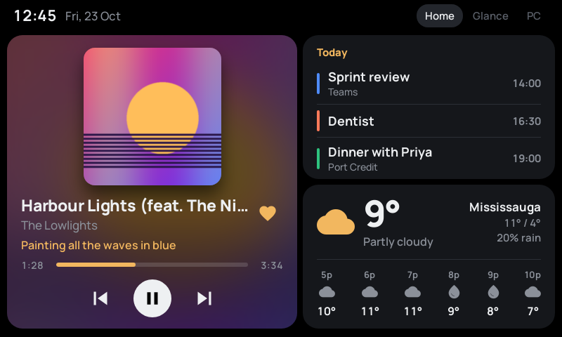
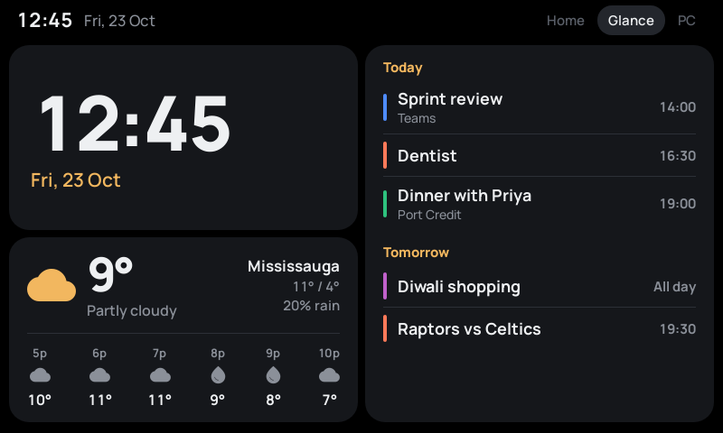
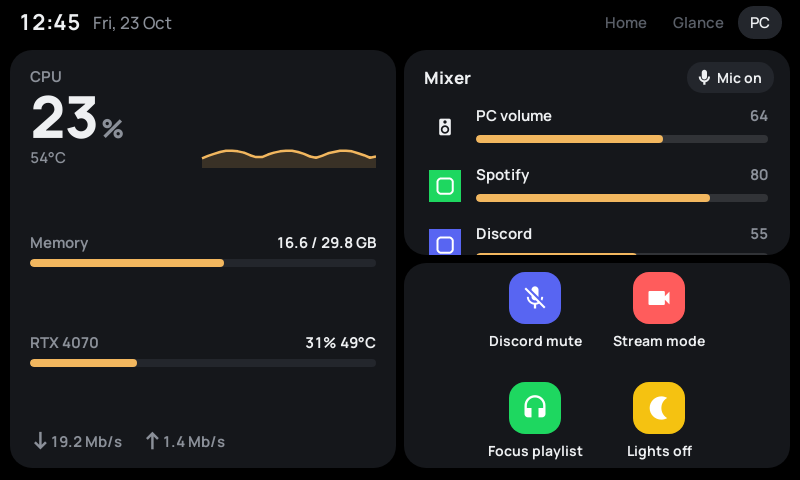
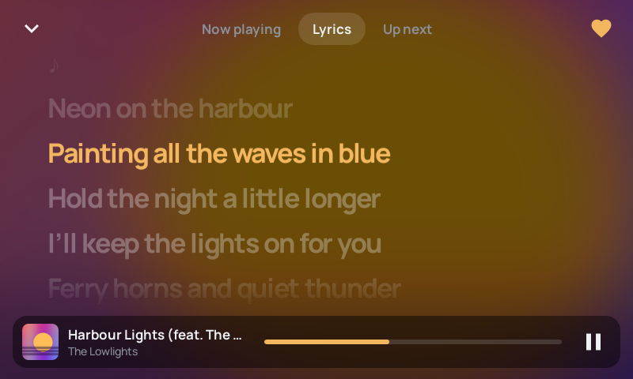
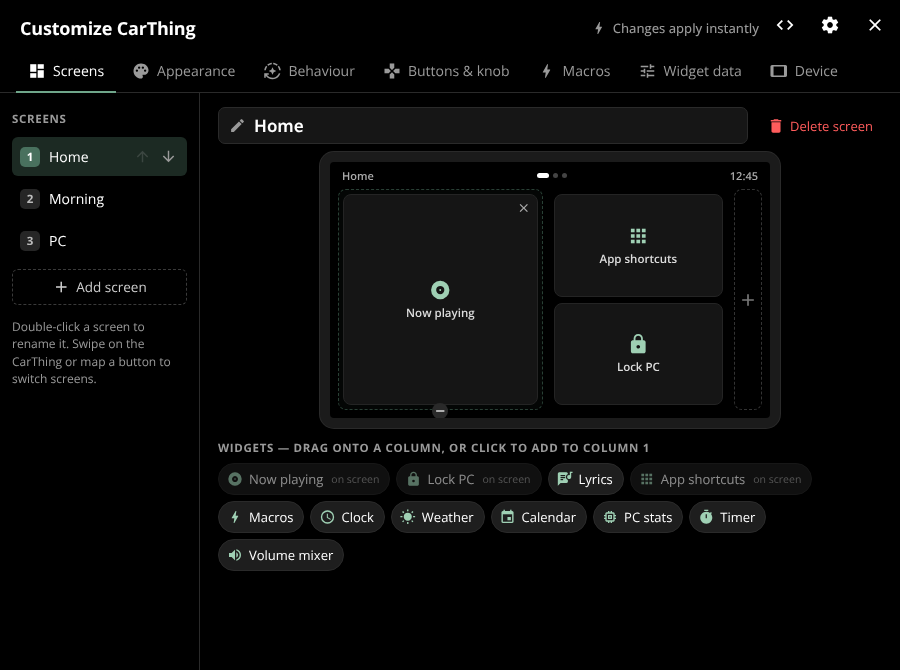
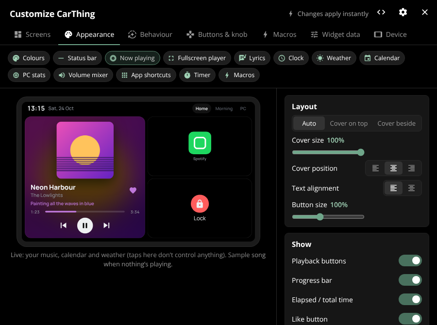

# VibeThing

Your CarThing as a desk companion.

VibeThing turns a Spotify CarThing plugged into your PC into a small second screen: what's playing (from any app, not just Spotify), your calendar, the weather, PC stats, a volume mixer, a timer and one-tap macros. You lay it all out yourself from the desktop app and watch it update live.

It's a customised fork of [GlanceThing](https://github.com/BluDood/GlanceThing) by BluDood.



## Features

**On the CarThing**

- Screens you design yourself: up to 3 columns of widgets per screen, as many screens as you like. Swipe between them or map a button to each.
- **Now playing** for Spotify, YouTube, VLC and anything else Windows can see. Video lengths come from Windows, and wide video thumbnails stay wide instead of being squashed square.
- **Fullscreen player** with synced lyrics and what's up next.
- **Calendar** (any ICS link), **Weather**, **Clock**, **PC stats** (CPU, memory, GPU, network), **Volume mixer** per app, **App shortcuts**, **Macros** and a **Timer**.
- Timer you set by turning the dial. It starts in 1 second steps and speeds up to 5 s, 10 s, 30 s and 1 min the longer you turn, and you get a Windows notification when it's done.
- Dark, black and flat-black themes, with an accent colour picked from the album art or chosen by you.

**In the desktop app**

- **Customize** opens straight away: drag widgets onto screens, rename and reorder screens.
- **Appearance** has a live preview of the CarThing. Change the text size and weight of every widget, the player layout (cover on top or beside, cover size and position), and what each widget shows.
- **Behaviour**:
  - Auto-switch screens when music starts or after it pauses.
  - Night mode that dims the CarThing on a schedule.
- **Buttons & knob**: decide what each top button does on press and hold, and what the dial does.
- **Device**: clock and date format, brightness, and whether it sleeps or shows a screensaver.
- **Backup**: export and import all your settings. Settings from an existing GlanceThing install are copied over the first time you open VibeThing.

<p>
  
  
</p>
<p>
  
</p>

## Getting started

VibeThing is built and tested for **Windows**.

1. Download `VibeThing-<version>-setup.exe` (installer) or `VibeThing-<version>-win-x64.zip` (portable) from [Releases](../../releases/).
2. Run it. The setup guide walks you through flashing your CarThing if it hasn't been done yet, then connecting it and choosing a music source.
3. Once your CarThing is set up, VibeThing opens straight to **Customize**.

You don't need GlanceThing installed. If you already use it, close it first, because only one app can talk to the CarThing at a time.

### VLC

VLC 3 doesn't report what's playing to Windows. Either install the [vlc-win10smtc](https://github.com/spmn/vlc-win10smtc) plugin, or turn on VLC's web interface and enter its password under **Customize → Widget data → VLC**.

## Using it



**Screens.** Pick a screen on the left, then drag widgets from the palette into its columns. Double-click a screen name to rename it.



**Appearance.** Choose a widget along the top. The preview on the left is your real CarThing layout, with your own music, calendar and weather when they're available. Every change is sent to the CarThing as you make it.

**Controls on the CarThing.** By default:

- Buttons 1–3 open your first three screens. Holding button 3 locks your PC.
- Button 4 opens the fullscreen lyrics. Holding it likes the current song.
- Turning the dial changes the volume, and pressing it plays or pauses.

All of these can be changed under **Buttons & knob**.

**Settings** (the gear in the top right) holds the app-level options: starting with Windows, starting minimised, backup and restore, logs and quitting VibeThing completely. Closing the window leaves VibeThing running in the system tray.

## Building from source

```bash
npm ci
npm run build:win   # builds the CarThing client and the app, output in dist/
```

`npm run dev` starts the desktop app with hot reload. Run `npm run dev` inside `client/` to work on the CarThing interface in a browser.

## Credits

- **[AdiJ13](https://github.com/adityajain13)**: creator of VibeThing.
- **[BluDood](https://github.com/BluDood)**: creator of [GlanceThing](https://github.com/BluDood/GlanceThing), which VibeThing is built on. The CarThing setup, connection and the original app all come from his work.
- **[ItsRiprod](https://github.com/ItsRiprod)** and [DeskThing](https://github.com/ItsRiprod/DeskThing), the inspiration for GlanceThing.
- The [Thing Labs CarThing community](https://discord.gg/car-thing-hax-community-1042954149786046604) for keeping the CarThing alive.

Built with Electron, electron-vite, React, TypeScript and Vite. Lyrics come from [LRCLIB](https://lrclib.net) and weather from [Open-Meteo](https://open-meteo.com).

Licensed under the MIT licence, the same as GlanceThing.
